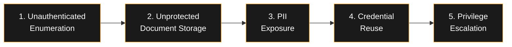
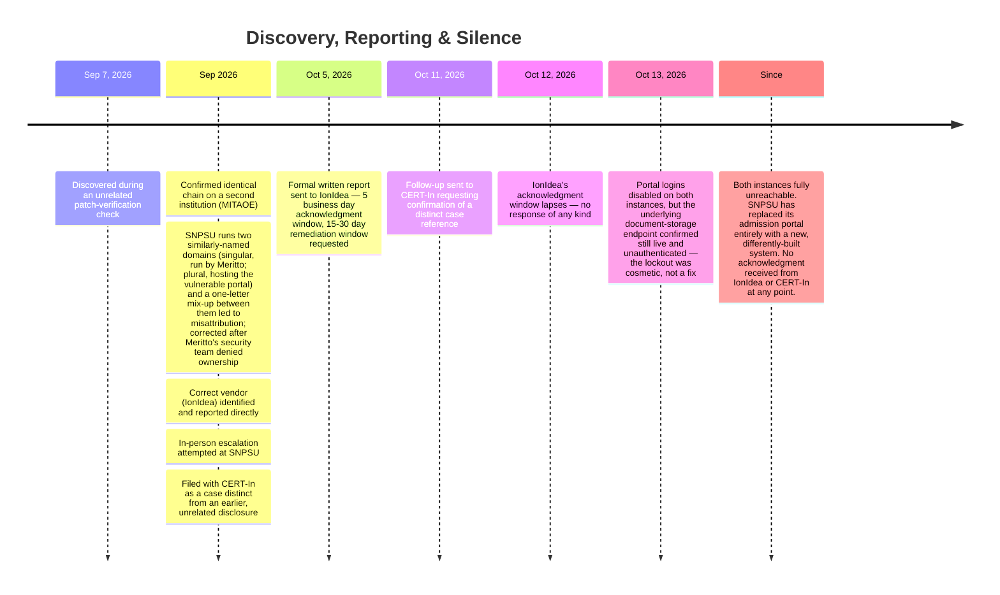
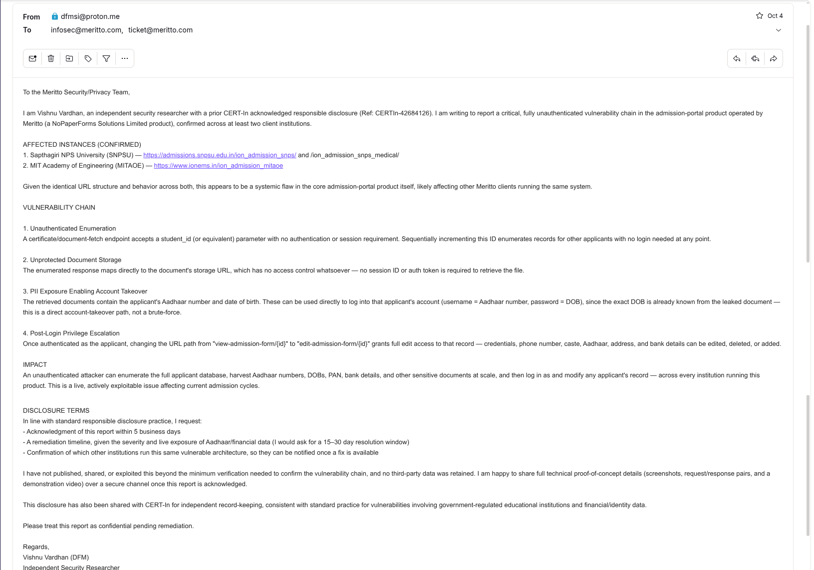
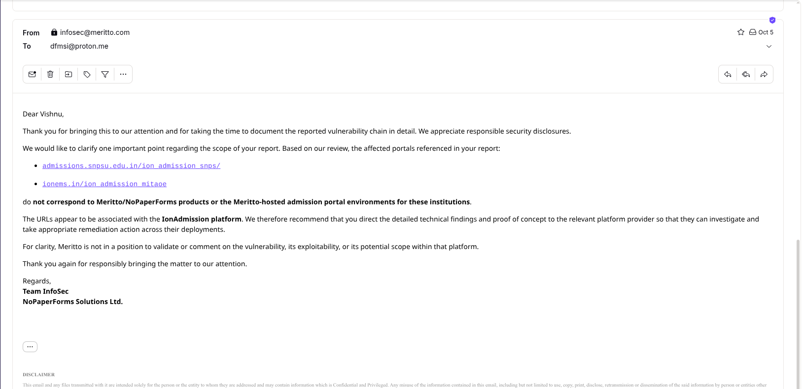
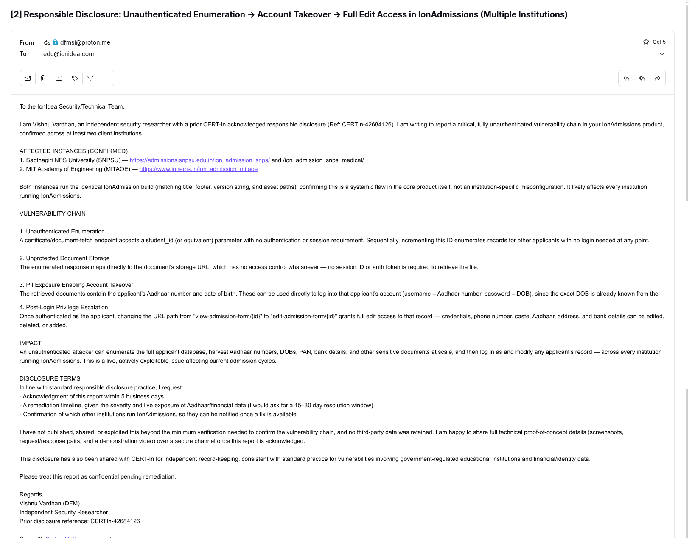
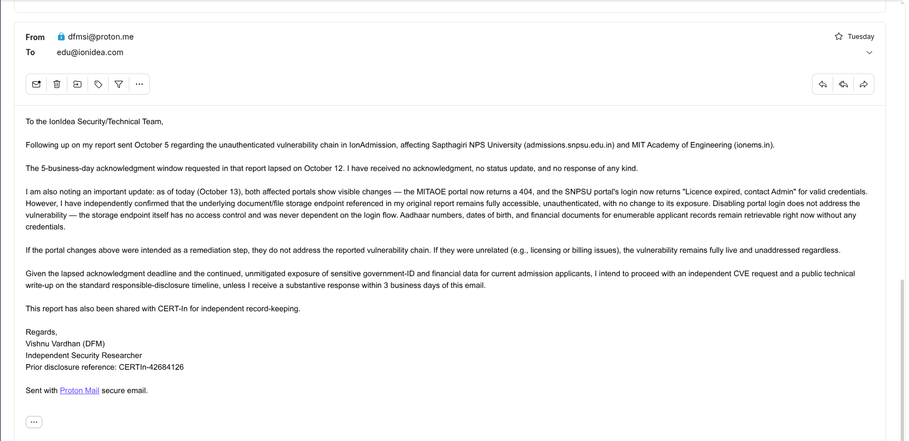
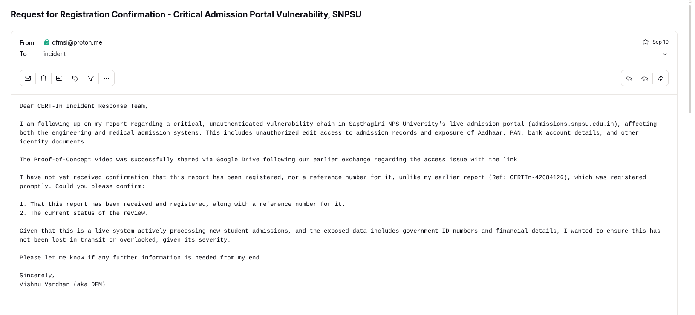
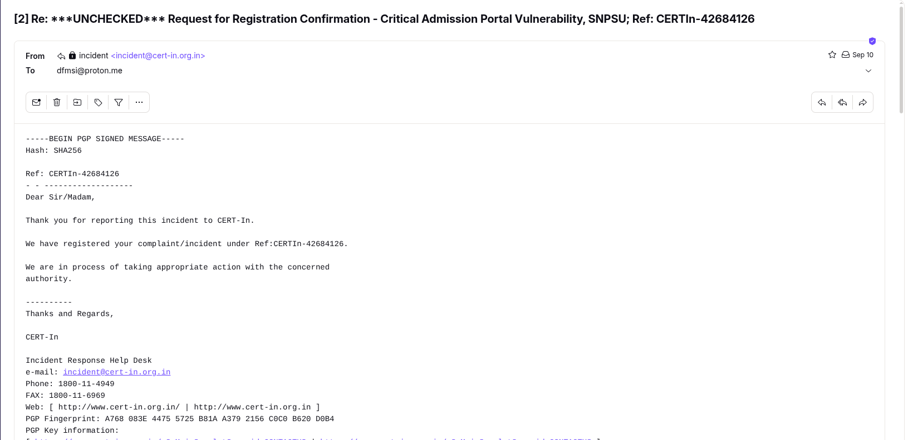
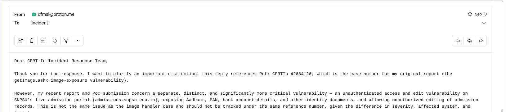
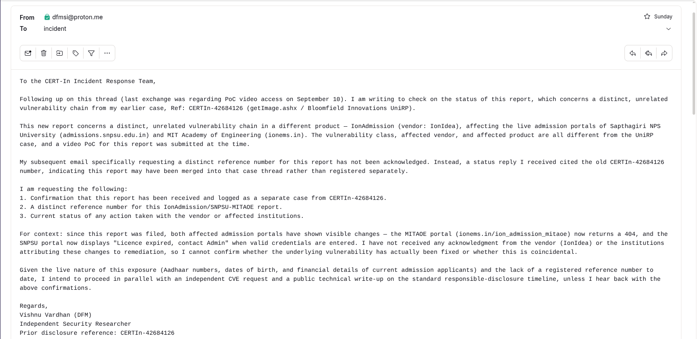

# Unauthenticated Vulnerability Chain in IonAdmission (Multiple Universities)

**Researcher:** Vishnu Vardhan (DFM) — Independent Security Researcher
**Status:** Both confirmed instances offline / replaced · No vendor or CERT-In acknowledgment received
**CWE:** CWE-639 (Authorization Bypass Through User-Controlled Key) · related: CWE-284, CWE-307

> **A note on scope before anything else:** this write-up documents the *structure* of the vulnerability chain, the reporting timeline, and the resulting silence — not the live endpoint names, request parameters, or path structure. That detail is withheld intentionally. See [Responsible Disclosure Notes](#responsible-disclosure-notes) at the bottom.

---

## Summary

Between September and October 2026, I identified and reported a multi-stage, fully unauthenticated vulnerability chain in **IonAdmission**, an admission-management product built by **IonIdea**. The chain was confirmed on two separate, unrelated university deployments:

- **Sapthagiri NPS University (SNPSU)** — `admissions.snpsu.edu.in`
- **MIT Academy of Engineering (MITAOE)** — `ionems.in`

Both instances shared an identical codebase, footer, and version string — confirming this as a systemic product-level flaw, not a one-off institutional misconfiguration. The chain allowed a completely anonymous visitor to enumerate applicant records, retrieve government-ID and financial documents without any authentication, log in directly as any applicant using data leaked from those documents, and then edit that applicant's record.

This is a separate issue from an earlier, unrelated disclosure I filed regarding a different endpoint (`getImage.ashx`) on SNPSU infrastructure — that report remains open and is **not** covered here.

## The Vulnerability Chain

| Step | What happened |
|---|---|
| **1. Unauthenticated Enumeration** | A certificate-retrieval request accepted an applicant identifier with no login or session required. Stepping the identifier returned a different applicant's record every time — no rate limiting, no authentication. |
| **2. Unprotected Document Storage** | The response for a given identifier mapped directly onto that applicant's stored document. The storage location had no access control of its own — no token, no session, nothing tying retrieval back to a login. |
| **3. PII Exposure** | The retrieved document contained the applicant's government ID number (Aadhaar) and date of birth, fully visible. |
| **4. Credential Reuse** | Those same two values were, by the product's own design, that applicant's login credentials. An anonymous document fetch became a fully authenticated session with zero guessing involved. |
| **5. Privilege Escalation** | Once authenticated, a single path segment in the application's own URL scheme (view vs. edit) was the only thing separating a read-only record view from a fully editable one — identity, contact, and financial fields all editable with no further authorization check. |

## Impact

| | |
|---|---|
| **Severity** | Critical |
| **Attack complexity** | Low — a browser was sufficient |
| **Authentication required** | None |
| **Data exposed** | Aadhaar/government-ID numbers, dates of birth, financial & admission documents |
| **Confirmed instances** | SNPSU, MITAOE (identical vendor build) |
| **Likely scope** | Any institution running this IonIdea product on the same build |

## Discovery, Reporting & Silence

### Vendor & CERT-In response, in full

- **CERT-In**: a status request on this case was answered citing the reference number of a prior, unrelated disclosure, rather than registering this report as a distinct case. A follow-up explicitly requesting a separate reference number went unanswered.
- **IonIdea**: the Oct 5 report, sent to their published security/technical contact, received no acknowledgment before or after the stated 5-business-day window. A final follow-up noting the lapsed deadline and the still-live storage endpoint also went unanswered.
- **Net result**: two independent institutions' applicant PII was exposed, unauthenticated, for the duration of this process, and neither the vendor nor the national CERT confirmed receipt at any point.

## Correspondence

Cropped screenshots of the actual sent/received correspondence (browser and mail-client chrome removed). Every reply shown is organizational — a vendor security team or CERT-In's incident desk — not a named individual, so no redaction beyond chrome removal was needed.

| | |
|---|---|
|  **Initial report sent (misattributed vendor)** — Oct 4, 2026 |  **Vendor denies ownership, identifies IonAdmission** — Oct 5, 2026 |
|  **Formal report sent to IonIdea** — Oct 5, 2026 |  **Follow-up — deadline lapsed, endpoint still live** — Oct 13, 2026 |
|  **CERT-In — requesting registration confirmation** — Sep 10, 2026 |  **CERT-In replies citing the old case reference** — Sep 10, 2026 |
|  **Clarifying this is a separate case** — Sep 10, 2026 |  **CERT-In follow-up — still unanswered** — Oct 11, 2026 |

## Why no CVE

There was never a vendor acknowledgment to anchor a CVE request to, both confirmed instances have since gone offline or been replaced, and a prior, unrelated CVE/MITRE request of mine never resulted in an assigned CVE either. This write-up and the corresponding CERT-In correspondence are the public record instead.

## Responsible Disclosure Notes

- No live endpoint names, request parameters, or path structure are published here or anywhere else connected to this report.
- No third-party applicant data was retained, published, or used beyond the minimum needed to confirm the chain existed; testing was stopped once severity was understood.
- Both confirmed instances are, as of writing, unreachable or replaced. If you operate or are aware of another institution running this product, treat this write-up as a reason to check your own deployment rather than as a reason to go looking at someone else's.
- Questions about the responsible-disclosure process, or about this specific case: **vishnuvardhan3965@gmail.com**
